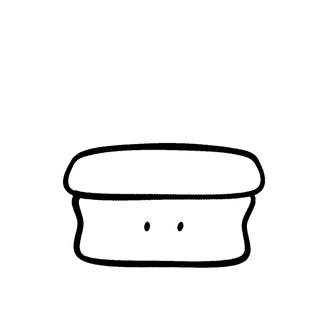
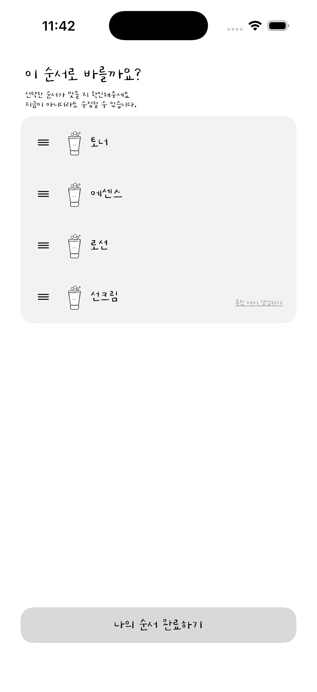
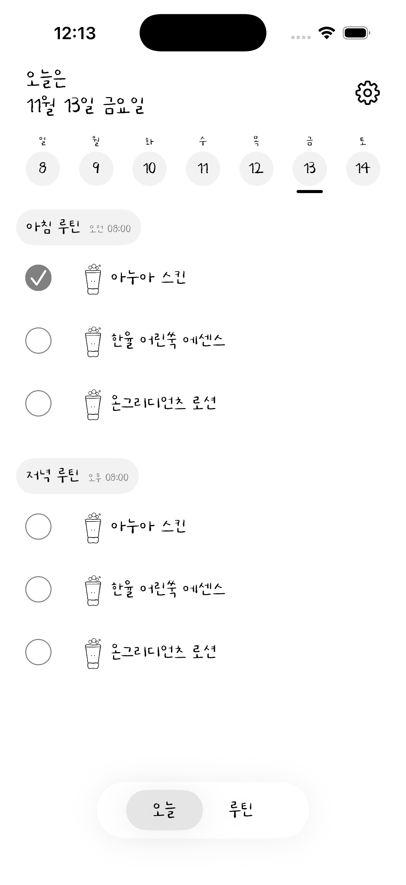
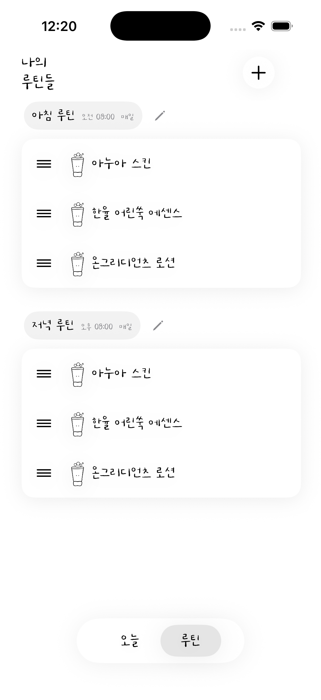
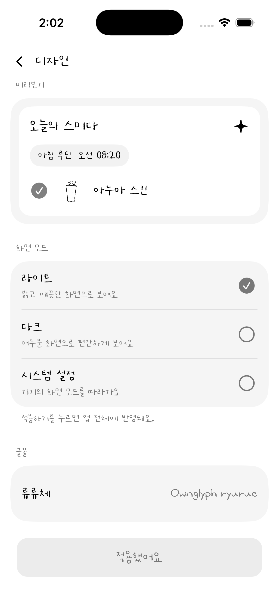

  
  <h1>스미다 · Seumida</h1>
  
매일의 피부관리가 습관으로 스미도록.

  
내 피부관리 순서를 만들고, 오늘의 루틴을 하나씩 실천하는 iOS 앱

## 스미다는

무엇을 어떤 순서로 발라야 할지 매번 기억할 필요 없이, 나만의 피부관리 루틴을 정하고 실천을 기록하는 앱입니다.

- **나만의 루틴:** 제품과 바르는 순서, 반복 요일과 시간을 설정해요.
- **오늘의 관리:** 날짜별 루틴을 확인하고 사용한 제품을 체크해요.
- **간편한 수정:** 루틴을 추가하고 제품·순서·일정을 바꿀 수 있어요.
- **나에게 맞게:** 피부 성향과 고민을 기록하고 라이트·다크 화면을 선택해요.

## 화면 미리보기

개발 중인 화면이며, 예시 데이터로 구성했습니다. 출시 시 화면과 기능은 변경될 수 있습니다.

<table>
  <tr><th>바르는 순서</th><th>오늘의 관리</th></tr>
  <tr>
    <td></td>
    <td></td>
  </tr>
  <tr><th>나의 루틴들</th><th>디자인 설정</th></tr>
  <tr>
    <td></td>
    <td></td>
  </tr>
</table>

## 개발 현황

현재 디자인과 주요 화면을 개발하고 있으며, 디자인 검토 후 실제 사용 흐름과 안정성을 QA할 예정입니다.

| 구분 | 상태 |
|---|---|
| 온보딩·오늘·루틴 관리 화면 | 구현 및 검토 진행 |
| 프로필 저장·디자인 설정 | 구현 및 검토 진행 |
| 루틴·기록 영구 저장, iCloud 동기화·복원 | 설계·구현 예정 |
| 알림·위젯·라이브 액티비티 | 구현 예정 |
| TestFlight·App Store 배포 | 준비 전 |

현재 공개 배포된 버전은 없습니다. 배포가 준비되면 이곳에 안내하겠습니다.

## 이 저장소에 대해

이곳은 **스미다의 공개 소개 저장소**입니다. 앱 소스코드와 내부 개발 문서는 별도 비공개 저장소에서 관리합니다.

- 제작: [CHS](https://github.com/CHSssssssss)
- 플랫폼: iOS
- 화면 글꼴: Ownglyph ryurue · 류류체

서비스에 대한 의견이나 기능 제안은 이 저장소의 Issues에 남겨주세요. 개인 정보가 포함된 화면이나 기록은 올리지 말아 주세요.
